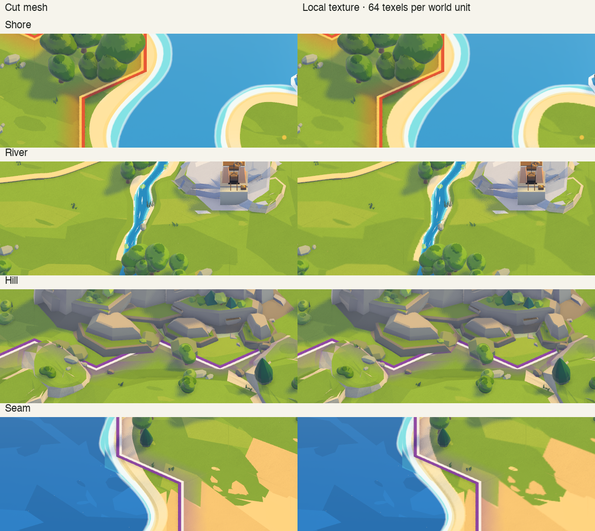
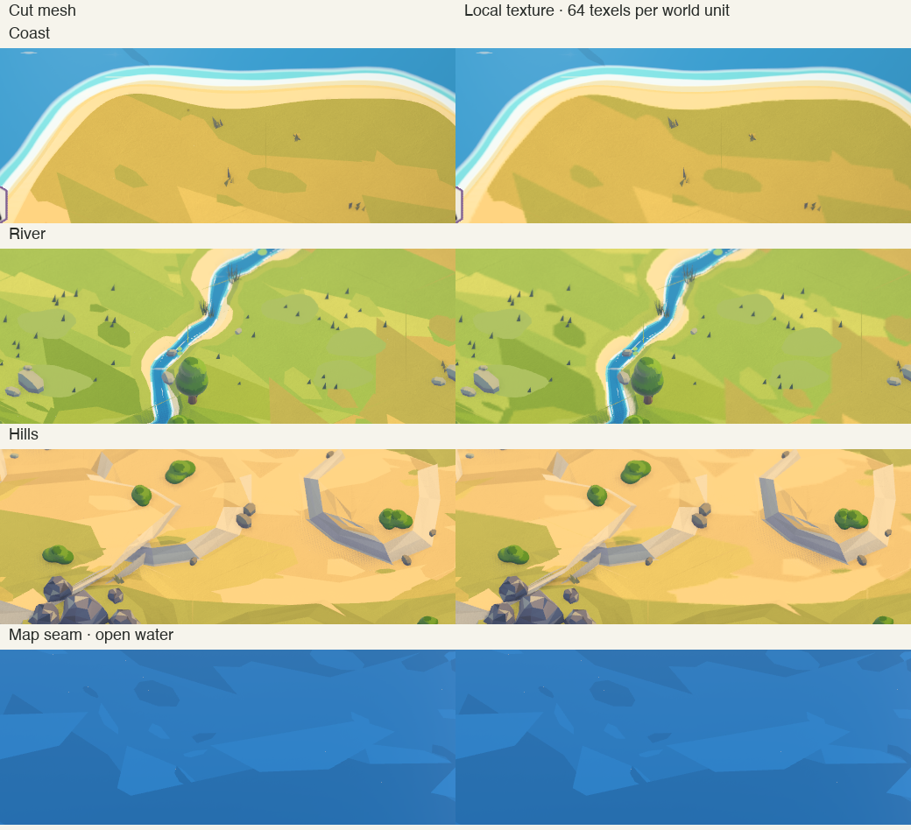
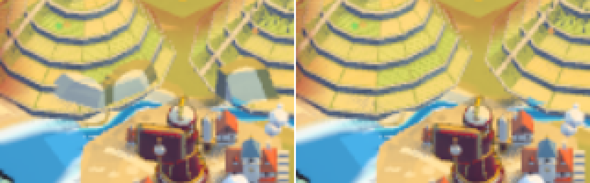

# Close ground texture trial, November 19, 2026

Open the game at `/?closeGround=1` and zoom all the way in. The trial bakes the visible ground at 64 texels per world unit. The regular game keeps its existing zoom switch. The visual decision remains open.

At closest zoom the most visible change is the softer edge where green ground meets sand. The river follows the same course, but its banks also soften. The hill silhouette and border follow the same lines. Each panel below is a 600 × 230 crop from the original 1920 × 1440 drawing buffer. The shore, river, hill and map seam use identical cameras on both sides.

## Motion and picking

Native WebKit rendered the 26 × 18 gallery on an Apple GPU with a 1280 × 960 viewport. The camera keeps a continuous x coordinate across the seam. The texture origin snaps to a texel. View coverage includes the ground mesh height bounds and the current camera pitch. The cut mesh draws while the view extends beyond the ready texture. The static shadow pass still uses the cut mesh.

| Gallery action | Cut frames / sampled frames | Elapsed until ready | Longest gap between sampled frames |
|---|---:|---:|---:|
| Half-unit pan | 0 / 1 | Already covered | Single sample |
| Two-unit refill after the small pan | 0 / 8 | 273 ms | 52 ms |
| Nine-unit drag | 7 / 8 | 275 ms | 38 ms |
| Jump to the seam | 7 / 8 | 318 ms | 50 ms |
| Cross the seam | 0 / 1 | Already covered | Single sample |

The elapsed column covers the whole refill. Each sample counts one display callback. These single runs include the rest of the board draw and host load. They do not establish a frame-time gain. On zooming out, the ordinary zoom rule selected the land mesh again.

On both the gallery and a generated Standard board (80 × 52, seed 42), all 140 tile picks matched between modes. All 20 unit contact heights also matched on each board, including the seam. The gallery used the warrior model and Standard used the settler model. The trial retains the current picking and placement geometry.

A separate six-seat Standard save (seed 20261116) loaded through Continue on the ordinary game URL with the option enabled. The painted board displayed the local texture at closest zoom. A jump to the seam used the cut mesh during the refill. Crossing the seam by half a unit then kept the same ready texture. Its base used 57.0 MiB and its ready local texture used 12 MiB.

## Giant allocation

WebKit allocated the real 8080 × 4380 base target at 25.92 texels per world unit and two 2048 × 1536 close targets. The base and both close targets completed their mipmaps. GPU completion after each allocation and each bake reported no WebGL error. The allocation test uses empty land batches and exercises the full target sizes.

| Ground paint storage | MiB |
|---|---:|
| Giant base including mipmaps | 180.005 |
| Two ultrawide close textures including mipmaps | 32 |
| One 1024 × 1024 square with four samples, resolved colour and depth | 40 |
| Estimated peak including the one-texel upload target | 252.005 |

These figures estimate attachment storage. Driver overhead, geometry and other renderer targets are separate. A full Giant board and its wide-view image at the lower base density remain unverified.

## Full Giant board

Native WebKit tried the complete 180 × 112 map with seed 42 and two seats on an Apple M4 with 16 GiB of memory. Both runs ended during land construction. Neither reached the base texture bake. WebKit reported that its content process had terminated. The operating system gave no cause in the capture.

| Terrain workers | Last reported land progress | Time from harness start to exit | Peak resident memory sampled for WebContent |
|---|---:|---:|---:|
| Shipping setting, up to four | 33% | Unmeasured | Unmeasured |
| One | 87% | 303 s | 3.24 GiB |

The second run sampled the WebContent process and host memory pressure for 300 seconds. Of 289 samples, 139 showed normal pressure and 150 showed a warning. The host already had 5,997 MiB of swap in use when the run began. Resident memory measures the process pages in RAM. It excludes compressed pages, swap and the separate GPU process. The complete board still needs a successful load before we can compare its wide view or time a pan. [Measurements](benchmarks/ground-close-giant-2026-11-19.json)

## Standard board at closest zoom

These are new crops from the native WebKit captures of seed 42 described above. Each crop keeps the original drawing-buffer pixels. Look at the pale band beside the river and the edge of the grass at the coast. Both have softer edges with the local texture. The seam in this seed crosses open water. The gallery comparison at the top of this page covers a seam on land.

On this board a nine-unit drag drew the cut mesh on eight of nine sampled frames and refilled the local texture in 578 ms. A jump to the seam needed 350 ms and drew the cut mesh on six of seven frames. A half-unit move across the seam used the ready texture. The game keeps its 1.5× drawing resolution and the existing cut-mesh option.

## Beach and river banks under terraces

The grey blocks on the left are pieces of bank that still stand at the old hill height. The painter clips the sand and river banks onto the hill. When terraces replace the mound, the renderer removes the hill faces. The clipped bank pieces carry no hill marker, so they stay. The textured ground on the right paints the bank onto the ground below the terraces. This is the original enlarged middle-zoom comparison from part 3 of the ground paint plan. A separate change to the cut mesh still awaits the visual decision.

## Cost of making the cut land

A separate CPU measurement used two generated Standard maps with the current hill, river and coast shapes. It built and painted the same sample of land tile tops with and without their cut copy. Four pairs per seed reversed the order between pairs.

| Seed | Land tiles | Cut and plain tops, median CPU time | Plain tops alone, median CPU time | Cut top arrays before merging |
|---:|---:|---:|---:|---:|
| 42 | 592 | 878 ms | 358 ms | 77.44 MiB |
| 999 | 589 | 932 ms | 346 ms | 76.51 MiB |

The plain tops kept the same triangle counts in both runs. These times cover tile construction and painting. Stage 4 would also need to send brush outlines, paint them into the texture, and supply the picker and shadow bake with the right surface. The time and peak memory for that complete operation remain open. [Sample measurements](benchmarks/ground-close-giant-2026-11-19.json)

## Repeat the trial

With the Vite dev server running, open `/scripts/terrain-study/close-ground.html` for the paired gallery captures. Select a picture to save its full-resolution PNG. Add `?size=standard` to use the generated board or `?allocation=giant` to test the Giant targets. The page records measurements in `window.trialReport`.

For a complete generated map, use `?size=standard` or `?size=giant`. The page also captures the wide view at a fixed river or hill. Add `&base=shipping` to open the same wide camera with the shipping atlas budget. Add `&workers=1` to repeat the single-worker build.
